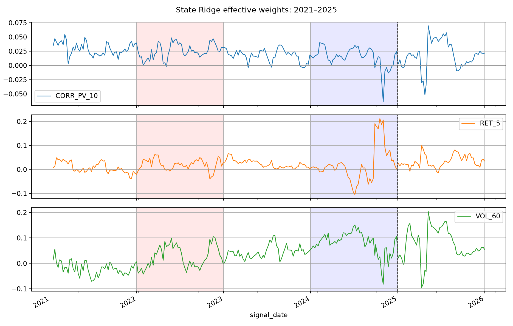

# 2025 年留出盲测复盘

[复跑说明](../../scripts/holdout_2025/README.md) · [留出期结果](results/holdout_summary.csv) · [冻结配置](../../scripts/holdout_2025/holdout_2025_spec.json) · [本次登记](results/registration.json)

2025 年全部六个模型落后于沪深 300 全收益指数（H00300：+20.98%）。含前 45 名缓冲时，六输入 LightGBM 在 10 bp 下为 +5.01%，仅比三输入树模型的 +5.00% 高 0.015 个百分点；在 20 bp 下由三输入树领先。开发期六输入模型的领先幅度没有在留出期延续，因此没有证据认定市场状态输入或结构化交互在样本外能稳定提升扣费收益。

| 模型 | 缓冲 | 单边 10 bp 净收益 | 单边 20 bp 净收益 | 10 bp 最大回撤 | 10 bp 平均双边换手 | 周 Rank IC |
|---|---:|---:|---:|---:|---:|---:|
| 三因子等权 | 45 | −1.66% | −6.71% | 7.92% | 101.76% | 0.0254 |
| 普通三因子 Ridge | 45 | +2.01% | −1.21% | 6.24% | 61.35% | 0.0157 |
| 三输入 LightGBM | 45 | +5.00% | **+3.53%** | 5.58% | 28.31% | 0.0195 |
| 原三因子状态 Ridge | 45 | +1.71% | −2.44% | 6.60% | 83.37% | 0.0212 |
| 原三因子状态 Ridge | 50 | +1.88% | −1.97% | 6.56% | 77.34% | 0.0212 |
| 三因子分离正则 Ridge | 45 | +2.19% | −1.45% | 6.26% | 67.07% | 0.0132 |
| 六输入 LightGBM | 45 | **+5.01%** | +1.37% | 6.34% | 68.03% | 0.0288 |

原状态 Ridge 的缓冲放宽到 50 后，两档费用收益都有改善，但 20 bp 下没有复现开发期转正。六输入树 Rank IC 更高，但其 10 bp 换手率是三输入版的约 2.4 倍；提高费用后，排名质量没有转化为相对三输入树的收益优势。六输入树 10 bp 累计收益落后基准 15.97 个百分点，信息比率 −1.08。

## 解释性证据

三因子权重的输入是“低原始值优先”的截面百分位，正的 VOL_60 系数表示偏向低波股票。2022 年 RET_5 平均生效权重为 0.02034，其中状态贡献为 +0.00426；2024 年 VOL_60 平均生效权重达到 0.07974（2022 年为 0.02785）。但 2024 年该权重的主效应已达 0.07872，全年平均状态增量仅 +0.00102；因此不能把权重上升主要归因于当期市场状态。逐周权重图中 2022 和 2024 分别以红、蓝底标出。

2021–2024 的 202 次六输入树滚动拟合中，市场波动、趋势、广度分别占全部分裂的 22.37%、18.15%、17.16%，对应累计 gain 占 24.63%、17.71%、19.02%。三项状态合计占 57.68% 分裂、61.37% gain；这表示模型频繁使用状态，不能用来证明其有样本外交易增量。

按开发筛选段固定中位数分组，取每周单因子百分位前后约 20% 的模型平均分差：

| 因子 | 2025 高波动 | 2025 低波动 | 2025 高趋势 | 2025 低趋势 |
|---|---:|---:|---:|---:|
| RET_5 | 0.0653 | 0.0246 | 0.0379 | 0.0282 |
| VOL_60 | 0.0022 | 0.0803 | 0.0779 | 0.0286 |
| CORR_PV_10 | 0.0223 | 0.0308 | 0.0336 | 0.0191 |

高波动 13 个信号周、低波动 40 周，高趋势 35 周、低趋势 18 周，含年末未执行信号。树模型在高波动周的短期反转倾斜较强，但在低波动周才对低波股给出较大的分差。这是模型对实际观察到的截面打分的分组比较，不能视为市场状态的因果效应，也不能直接解释实际收益。

## 模拟台账与验收

2025-12-26 收盘生成信号，12-29 是留出期内实际走过成交引擎的最后一次模拟调仓。14 组共 420 条目标持仓及 580 条候选订单行，其中买入请求 217 条、卖出请求 160 条、零请求 203 条；申请量与模拟成交量分别记录。全期订单账本 29,448 行，并保存公司行动流水。另附 12-31 的六组未缓冲信号，其下一执行日是 2026-01-05；未假设 2026 年成交。

所有组合均无未核验持仓事件、无沿用旧收盘价的估值日；已复核每日净值、股数变化、现金约束和 SQLite 完整性。2025 数据未用于更改配置，成熟标签按既定规则进入后续训练。登记文件哈希请见 registration.json。归档的交易是历史纸面回放；仍需用未来实际可用的时点数据另开前向模拟账本。
