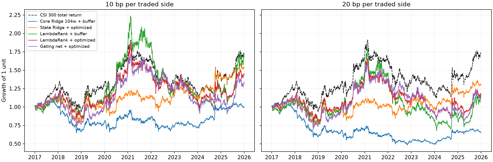

# 沪深 300 市场状态多因子 V3 开发报告

2015–2025 年完成了从点时成分、因子筛选、滚动预测到交易账本的开发实验。全周期内，LambdaRank 结合持仓缓冲在 10 bp 下接近沪深 300 全收益指数。状态 Ridge 结合优化器在 20 bp 下保留了最多的累计净收益，但仍落后于指数。2026 年只用于登记后的保留段评价。

## 数据、因子和标签

历史成分覆盖 562 个信号周、168,600 条周度成分记录和 658 只证券。信号日只使用更新时间截至当日的成分股，股票行情保留不复权和后复权两种口径。入场和退出收益用后复权开盘价，交易账本用不复权成交价并单独入账公司行动。行情复权标记异常隔离，共 512 条。账户使用相同的初始资金、交易规则和费率计提方式。

从 15 个候选因子中固定了 6 个。下表是各因子原值对市场调整后收益的周均 Rank IC。入选方向按 2015–2018 年决定，并要求在 2019–2022 年方向一致、达到门槛，五分组价差支持该方向。通过门槛后，按初筛段绝对 Rank IC 排序，剔除与已入选因子周度绝对秩相关中位数达到 0.75 的候选。

| 因子 | 2015–2018 Rank IC | 2019–2022 Rank IC | 打分方向 |
|---|---:|---:|---|
| TURN_20 | -0.0542 | -0.0389 | 低换手优先 |
| CORR_PV_10 | -0.0429 | -0.0455 | 低价量相关优先 |
| RET_5 | -0.0343 | -0.0255 | 短期反转 |
| BIAS_20 | -0.0308 | -0.0297 | 低价格乖离优先 |
| RET_60 | -0.0275 | -0.0283 | 低历史收益优先 |
| MOM_20_SKIP5 | -0.0193 | -0.0238 | 低历史收益优先 |

RET_60 和 MOM_20_SKIP5 的方向来自实证，两者在本样本呈反转效应。换手字段使流动性维度进入因子集。EP_TTM 与 BP_MRQ 未达到跨期门槛，VOL_60 未通过市场调整标签的验证价差条件，但保留在三因子对照中。缺失的候选因子在入模截面用中性百分位，各模型使用共同的候选股票范围。

标签为股票下一执行期开盘至再下一执行期开盘的收益，减去信号日估计的 120 日 Beta 与同期沪深 300 价格指数收益之积。Beta 至少需要 100 对有效交易日收益，估计结果限制在 0.2–2.2。该残差仍可能含其他系统性风险。净值对比用沪深 300 全收益指数 H00300。因子选择使用到 2022 年，因此 2017–2022 年的模型结果是回顾性开发证据。

## 滚动训练和模型比较

信号日收盘后计算股票因子百分位与四项市场状态。市场状态包括 20 日趋势、20 日波动率、上涨广度、高波相对低波股票的 20 日收益差。只用已退出并可观察结果的训练周，最多回看 260 周，最少 52 周。对照组分别检验 104 周与 260 周记忆、原始与市场调整标签、市场状态相似度加权。

| 模型 | 市场调整后 Rank IC | ICIR | 前 30 命中率 |
|---|---:|---:|---:|
| 三因子 104 周 Ridge | +0.0532 | +0.301 | 6.10% |
| 三因子 260 周 Ridge，原始标签 | +0.0528 | +0.312 | 5.98% |
| 三因子 260 周 Ridge，市场调整标签 | +0.0539 | +0.319 | 5.31% |
| 六因子状态 Ridge | +0.0501 | +0.308 | 7.01% |
| 六因子状态相似度加权 Ridge | +0.0519 | +0.319 | 6.80% |
| 六因子 LambdaRank | -0.0018 | -0.013 | 14.78% |
| 六因子门控网络 | -0.0193 | -0.114 | 16.32% |

以上覆盖 460 个标签已成熟的评价周。前 30 命中率是模型头部和真实收益头部的交集占 30 的比例。非线性模型头部命中更高，但全截面 Rank IC 为负，同时对 2025 年行情尤为敏感。

- 状态 Ridge 对主效应和状态交互项分别施加 0.05 与 0.5 的惩罚。相似度对照按标准化历史状态与当期状态的距离加权。
- LambdaRank 用每周实际市场调整收益的五档相关性训练，目标集中在头部排名。树最多 3 层、80 轮，每四周重训一次。预测沿用最近一次拟合时的状态标准化。
- 门控网络受 MASTER 启发。四项市场状态经小型 MLP 生成因子缩放权重，再通过非线性打分头输出排序。按整周的小批量计算 ListNet 损失，使用 AdamW 与热启动。开发机没有 PyTorch，实际运行使用 NumPy 实现，冻结沿用同一后端。

## 组合与成本

组合层对比前 30 名配合排名 45 的持仓缓冲，以及带换手惩罚、单股上限和状态 Beta 区间的长仓优化器。优化器在当天开盘按实际持仓的市值估算现有权重。连续问题使用两个标量乘子求解，并以独立的 SLSQP 小样本检查了目标函数及约束。实际成交按开盘、手数、停牌和涨跌停规则撮合。换手率为每次调仓买卖总额除以开盘资产。费率按每笔成交额分别计提。22 条策略账本的未核验公司行动持仓暴露均为零。

| 2017–2025 实验 | 10 bp 净收益 | 20 bp 净收益 | 10 bp 平均双边换手 | 10 bp 的 2025 收益 |
|---|---:|---:|---:|---:|
| 三因子 104 周 Ridge + Buffer | -1.25% | -34.90% | 93.17% | -1.62% |
| 六因子状态 Ridge + Buffer | +13.51% | -21.22% | 81.00% | -7.12% |
| 六因子状态 Ridge + 优化器 | +52.87% | +29.89% | 36.12% | +5.39% |
| LambdaRank + Buffer | +71.81% | +15.47% | 83.18% | +44.03% |
| LambdaRank + 优化器 | +44.86% | +18.04% | 41.30% | +16.96% |
| 门控网络 + Buffer | +31.66% | -13.79% | 71.36% | +52.48% |
| 门控网络 + 优化器 | +33.76% | +16.56% | 35.44% | +25.52% |
| 沪深 300 全收益 | +72.45% | +72.45% | — | +20.98% |

优化器减少了三个模型的换手，改善了 20 bp 情景的净收益。动态 Beta 区间在连续目标层有效。以冻结的状态 Ridge 主方案为例，进攻状态下目标 Beta 均值 0.951，成交后按已知持仓估算的均值 0.906，只有 2.29% 的调仓日达到原区间。成交后暴露受现金、离散手数、受限订单和未知 Beta 小额仓位共同影响。状态 Ridge 优化版在 2025 年虽比同模型 Buffer 提高约 12.50 个百分点，仍弱于指数。因此不能把降低换手、连续约束达标和解决牛市参与不足当作同一个结论。

## 冻结与复现

主前向方案选择六因子状态 Ridge 加优化器，因为它在相同的 20 bp 比较中累计净收益最高，且全截面 Rank IC 为正。此选择来自开发期，不代表 2026 预期收益。冻结登记保存候选变体、模型与组合参数、源文件哈希、关键开发产物哈希和运行环境。2026 仍将执行全部登记的对照。

结果表位于 `results/development/`，逐笔成交、持仓、公司行动和目标权重位于 `results/step4/`。原 V1 104 周记忆对照在 V3 统一候选范围和执行口径上重建，不能与 V1 冻结报告中的原始策略收益直接拼接。2026 年此前有 V1 前向输入留存。本项目将此次实验称为 V3 冻结后的保留段评价。2026 行情、净值和前向订单仍待数据交接。
