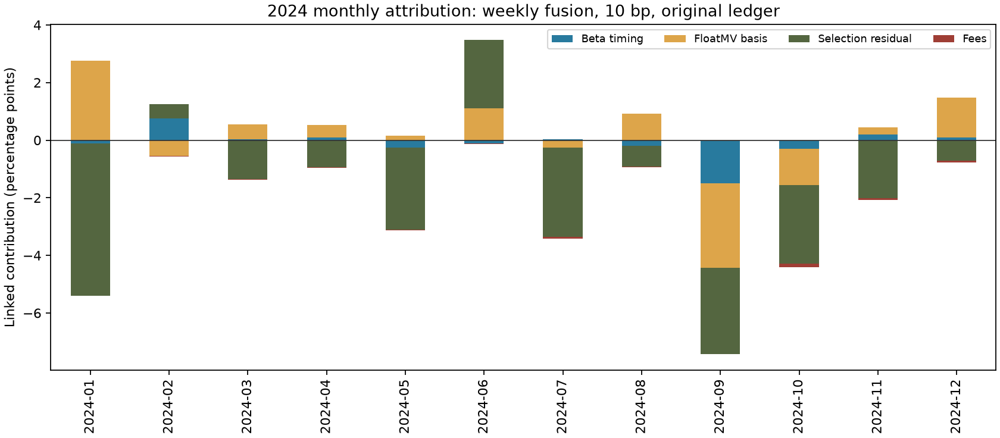

# V3.1 开发报告：2024 归因、账本对账与方向约束

2024 年的 **−19.99 个百分点**来自原账本的周频 50/50 融合、EMA 0.3、10 bp 成交费率、20 bp 换手惩罚、风险厌恶 15 和主动偏离上限 2%。全年最大的负项是剔除基准差、Beta 和手续费后的选股残差。上半年持仓实际低配了 EP 与 SP。9 月 24 日至 10 月 8 日的急涨窗口，较低的市场暴露和 FloatMV 基准差共同拖累。三笔公司行动已完成入账，64 条组合账本和 4 条非负约束对照均通过核验。

## 2017–2025 六因子有效权重

每个信号日用状态交互后的实际 Ridge 系数拆出各因子贡献，按年平均。下表为周频预测的六个有向截面百分位系数。

| 年度 | CORR_PV_10 | RET_5 | MOM_120_SKIP20 | HIGH_52W_PROX | SP_TTM | EP_TTM |
|---|---:|---:|---:|---:|---:|---:|
| 2017 | 0.0734 | 0.0549 | 0.0094 | 0.0163 | 0.0258 | 0.0322 |
| 2018 | 0.0691 | 0.0542 | 0.0391 | 0.0068 | 0.0340 | 0.0163 |
| 2019 | 0.0759 | 0.0336 | 0.0269 | 0.0185 | 0.0251 | 0.0133 |
| 2020 | 0.0732 | 0.0375 | 0.0460 | 0.0314 | 0.0025 | -0.0028 |
| 2021 | 0.0693 | 0.0438 | 0.0677 | 0.0449 | 0.0135 | -0.0199 |
| 2022 | 0.0728 | 0.0266 | 0.0441 | 0.0021 | 0.0016 | -0.0179 |
| 2023 | 0.0533 | 0.0163 | 0.0509 | -0.0019 | -0.0051 | -0.0115 |
| 2024 | 0.0454 | 0.0192 | 0.0409 | 0.0259 | -0.0089 | -0.0007 |
| 2025 | 0.0313 | 0.0285 | 0.0164 | 0.0304 | -0.0052 | 0.0280 |

2024 年周频 Ridge 的 EP、SP 系数分别有 **60.78%** 和 **82.35%** 的观察周为负，双周对应 **64.71%** 和 **72.55%**。两项的年均系数在 2024 年以前已出现负值。周频组合在 2024 年上半年相对 FloatMV 的 EP、SP 有向截面暴露均值约为 **−0.123、−0.129**。这些记录证实选股评分反向和长仓低配确实发生。

[年度权重表](results/step4/annual_effective_weights.csv) 覆盖 5、10、20 日预测的原生 Ridge 系数，以及 Huber、50/50 EMA 融合的每周标准化分数对六因子的线性投影。Huber 与融合的投影是解释量，量纲不同于 Ridge 原生系数。[2024 月度权重](results/step4/monthly_2024_effective_weights.csv) 与周度 Parquet 可复查每段的符号比例。

## 2024 年四项归因

表中均为百分点，对照的是首次回测出现 −19.99 个百分点的原始账本。年度和各窗口分别按自身范围复利链接。

| 区间 | 相对 H00300 | Beta 择时 | FloatMV 基准差 | 选股残差 | 手续费 |
|---|---:|---:|---:|---:|---:|
| 全年 | -19.99 | -1.21 | +3.72 | -22.01 | -0.50 |
| 上半年 | -3.19 | +0.31 | +4.66 | -8.04 | -0.13 |
| 7 月 1 日至 9 月 23 日 | -4.77 | -0.13 | +0.55 | -5.12 | -0.07 |
| 9 月 24 日至 10 月 8 日 | -8.88 | -1.97 | -5.06 | -1.84 | -0.00 |
| 10 月 9 日至年末 | -2.94 | +0.19 | +1.66 | -4.54 | -0.24 |

上半年的低配与负选股残差同时存在。924 窗口的组合平均前一收盘估计 Beta 为 **0.829**，基准差和 Beta 合计约 **−7.03 个百分点**。低市场暴露集中影响这段反弹。全年结果以选股残差为主要负项。四项加总与净超额逐段核对，四舍五入可能造成表面尾差。

Beta 择时以组合前一收盘的持仓 Beta 减 FloatMV 近似 Beta，再乘 H00300 日回报。FloatMV 的 Beta 由最近一次有效权重与当时估计的个股 Beta 近似。这样基准差本身承担 FloatMV 相对官方指数的收益差。另列以市场 Beta 1 为参照的诊断值，924 窗口约为 **−6.22 个百分点**。手续费取模拟账本实扣值。选股残差还可能包含未建模的暴露和日内执行误差，因此它只约束对亏损归类的解释。

[年度三基准与归因](results/step4/annual_attribution.csv) · [2024 季度](results/step4/quarterly_2024_attribution.csv) · [2024 月度](results/step4/monthly_2024_attribution.csv) · [924 窗口](results/step4/windows_2024_attribution.csv)

## 公司行动入账

按登记日收市实际持仓计算贵州茅台 2022 年特别分红，每股 21.91 元。受到该事件影响的首轮及网格账本中，35 条核对了对应的入账金额。武钢换宝钢按 0.56、海通换国泰君安按 0.62，在分别核对权益日期、退市和上市后补入可交易股数。64 条账本中有 2 条武钢及 3 条海通换股记录。原代码退出后，换股权益以原证券最后可得估值暂记，换得股份在上市日按新证券开盘可交易价估值。已逐条核对旧证券退出、精确整数换股、新股入账和零期末陈旧仓位。 [原始公告与条款](results/step3/company_action_evidence.md) · [合规状态](results/step3/step3_status.json)

## 非负方向复测

在每周预测端对已定向的六个 Ridge 有效系数施加下限 0。Huber 分数、50/50 融合、EMA 0.3、Beta 限额、tc20、风险厌恶 15 和主动上限 2% 按相同执行口径重放。比较基准为已修复公司行动的原始因子方向版本。绝对回撤和相对 H00300 回撤均以该年初单独归一。

| 调仓与实际费率 | IR 原值 → 非负 | 2024 超额原值 → 非负 | 2024 绝对回撤原值 → 非负 | 2024 超额回撤原值 → 非负 |
|---|---:|---:|---:|---:|
| 周频 10 bp | 0.457 → 0.534 | -19.76 → -17.16 pp | 15.30% → 14.71% | 17.32% → 18.12% |
| 周频 20 bp | 0.325 → 0.474 | -19.25 → -17.41 pp | 15.72% → 14.74% | 17.30% → 18.33% |
| 双周 10 bp | 0.372 → 0.385 | -18.13 → -15.82 pp | 14.88% → 15.98% | 16.85% → 17.31% |
| 双周 20 bp | 0.280 → 0.314 | -19.93 → -16.16 pp | 15.85% → 16.17% | 18.17% → 17.53% |

周频 10 bp 约束后的累计净超额相对 H00300、FloatMV、CSI300_EW 分别为 **+69.88、+50.05、+96.03 个百分点**。2024 年选股残差从 −21.83 改善到 −18.85 个百分点。约束后的周频和双周均通过两档累计超额、2025 表现、换手、进攻期 Beta、信号命中率和账本安全检查。**10 bp IR 仍低于 0.60**，周频最高为 0.534。方向约束是开发期诊断复测，2026 冻结盲测尚未启动。 [方向对照](results/step4/direction_experiment_comparison.csv) · [逐项门槛](results/step4/freeze_gate_audit.csv)

## 单调 Huber 与两种 Beta 政策的配对验证

2017–2025 年的两套组合共用逐股非负 Ridge 预测、同一份单调 Huber 预测、截面标准化后的 50/50 融合以及周频 EMA 0.3。每组在相同的 437 个调仓日执行，保持 20 bp 优化器换手惩罚、风险厌恶 15、主动偏离上限 2% 和仓位缓冲 0.96。静态政策的 Beta 区间是 [0.95, 1.05]，动态政策在进攻、中性、防守状态的区间分别为 [0.98, 1.08]、[0.92, 1.00]、[0.82, 0.92]。IR 用净组合与 H00300 的日收益之差计算并按 252 个交易日年化。

| Beta 政策 | 成交费率 | 累计净收益 | 相对 H00300 累计超额 | IR | 周等效双边换手 | 进攻期实际 Beta 落入 [0.98, 1.08] |
|---|---:|---:|---:|---:|---:|---:|
| 动态 | 10 bp | +125.36% | +52.90 pp | 0.4018 | 13.66% | 79.17% |
| 静态 | 10 bp | +123.59% | +51.14 pp | 0.4049 | 12.27% | 60.12% |
| 动态 | 20 bp | +114.75% | +42.30 pp | 0.3330 | 13.58% | 76.19% |
| 静态 | 20 bp | +117.13% | +44.68 pp | 0.3634 | 12.25% | 61.90% |

固定动态 Beta 和非负 Ridge 时，单独给 Huber 增加原生约束使 10 bp IR 从 0.5337 降到 0.4018。再切换到静态 Beta，10 bp IR 仅回升 0.0032，累计净超额降低 1.77 个百分点；20 bp 下静态的净超额高出 2.38 个百分点。静态政策在两档费率下都降低了换手。两组都用了状态因子评分，该配对只能检验给定评分后的 Beta 政策差异。

树模型共重训 115 次。在 460 个信号周中，每周抽取 12 只股票，对六个已定向因子各做一次从截面中心化百分位 −0.25 到 +0.25 的变化。固定其余输入列时，33,120 次检查中分数下降 0 次。同时重算相应状态交互列时，下降 10,240 次（30.92%）。LightGBM 原生约束控制单列偏效应，交互列仍能改变总响应。[逐列约束](results/step4/symmetric_beta/feature_constraints.json) · [逐周检查](results/step4/symmetric_beta/monotonicity_probes.csv)

**冻结判定为 No-Go。** 两种政策均通过两档累计超额、2025 表现、换手和信号命中率检查。436 个有成熟标签的决策信号的 Top 30 命中率为 12.26%，四本账的待核敞口与期末陈旧持仓均为零。两种政策均未通过全期 IR 及原进攻期 Beta 命中率红线。静态政策单独按自己的 [0.95, 1.05] 边界核对，进攻期命中率分别为 77.38% 和 79.17%。最高 10 bp IR 低于 0.55，未触发修订门槛或 2026 登记。[四组结果与三基准](results/step4/symmetric_beta/paired_results.csv) · [逐项验收](results/step4/symmetric_beta/gate_audit.csv) · [开发期决定](results/step4/symmetric_beta/decision.json)

在项目根目录运行 `.\.venv\Scripts\python.exe -B scripts/v3_1/run_v3_1_symmetric_beta.py` 可从已有开发期数据依次复现训练、四本账和判定。
