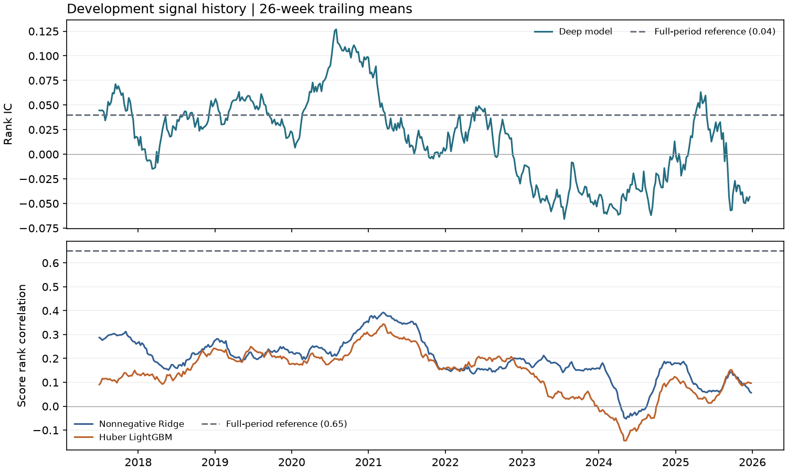

# V4 独立信号审计

第二阶段判定为 **NO_GO**。全期覆盖 460 个预测周、39 次重训，每次采用三个随机种子。下表按当周可评分的点时股票池计算。

| 区间 | 有效周数 | Rank IC | 周度 ICIR | Top 30 命中率 | Top 30 相对 H00300 平均五日收益差 |
|---|---:|---:|---:|---:|---:|
| all | 459 | 0.0159 | 0.100 | 11.07% | +11.7 bp |
| 2017-2022 | 307 | 0.0367 | 0.264 | 11.83% | +23.2 bp |
| 2023-2025 | 152 | -0.0261 | -0.139 | 9.52% | -11.8 bp |

| 准入标准 | 结果 |
|---|---|
| 全期 Rank IC ≥ 0.04 | 未通过 |
| Top 30 命中率 ≥ 12% | 未通过 |
| 与非负 Ridge 的平均秩相关 < 0.65 | 通过 |
| 与原 Huber 的平均秩相关 < 0.65 | 通过 |

开发期独立信号门槛未全部通过，项目停在第二阶段。2026 留出期继续封存。

命中率取预测前 30 名与风险调整收益前 30 名的交集占比。收益差按等权持股计算，尚未扣除费用。周度 ICIR 取 Rank IC 均值除以样本标准差。

每周在三个模型均有分数的股票上计算截面秩相关，再对各周等权平均。深度模型与非负 Ridge 的相关系数为 0.1925，与原 Huber 的相关系数为 0.1379。[分段相关性](orthogonality.csv)和[共同股票池结果](v4_signal_audit.csv)可供复核。

## 首个重训窗口的静态消融

| 模型 | 周数 | Rank IC | Top 30 命中率 |
|---|---:|---:|---:|
| v4_deep_tcsa_mgg | 12 | 0.0129 | 10.83% |
| without_attention | 12 | 0.0335 | 9.44% |
| without_gating | 12 | 0.0318 | 7.78% |

首季度保留跨股注意力对应的 Rank IC 差为 -0.0206，Top 30 命中率差为 +1.39 个百分点。

首季度保留市场门控对应的 Rank IC 差为 -0.0189，Top 30 命中率差为 +3.06 个百分点。

三种结构分别重训，使用相同的训练窗、验证窗、种子与预测股票池。去注意力版本整体移除跨股注意力及其残差归一化块。去门控版本把通道乘数固定为 1。这一组消融仅覆盖首个季度。

## 市场状态与门控

| 状态维度 | 状态 | 信号周 | 均值 | 与 1 的平均绝对距离 |
|---|---|---:|---:|---:|
| market_regime | defensive | 200 | 1.0098 | 0.0964 |
| market_regime | neutral | 83 | 1.0108 | 0.0855 |
| market_regime | offensive | 177 | 1.0211 | 0.0982 |
| style_regime | trend | 251 | 1.0106 | 0.0880 |
| style_regime | value | 209 | 1.0188 | 0.1036 |

市场状态沿用 V3.1 的进攻、中性、防御定义；价值与趋势按 60 日风格收益差的符号区分。独立重训可以重新排列隐通道。逐通道解释应在同一次重训、同一个种子内比较。[逐通道分状态记录](gate_means_by_refit_seed_regime.csv) · [同模型内状态差](gate_within_refit_contrasts.csv) · [逐项门槛](decision.json)
