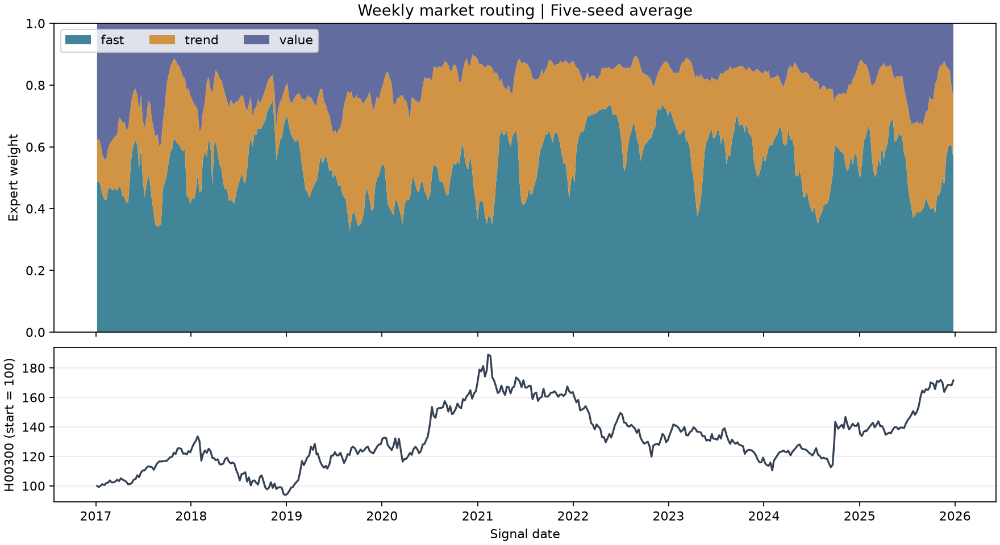

# V4.1 三专家门控开发报告

## 研究设计

三路专家各取两项已定向因子的等权平均。先在当期全体 300 只成分股上按均值正负三个标准差缩尾、标准化，缺失填零，再对组分数标准化。五维状态使用截至当期的 12 周序列，标准化统计量只使用该次扩展训练窗的成熟信号周。759 个参数输出三个非负、和为一的风格系数。专家分数可以为负，非负路由约束的是风格系数。

39 次重训，每次 5 个种子、全批量 25 轮。周度可微 Pearson IC 的均值除以其总体标准差加 0.05，另含相邻周权重平滑及等权先验惩罚。六因子名单来自已使用 2015–2022 数据选因子的 V3.1，2017–2025 的成绩均属开发证据。

## 信号与门控

| 信号 | 区间 | Rank IC | ICIR | Top 30 命中 | 五日费前超额 |
|---|---|---|---|---|---|
| v3_1_nonnegative_ridge | all | 0.0423 | 0.238 | 11.29% | +0.222% |
| v3_1_nonnegative_ridge | 2017-2022 | 0.0452 | 0.264 | 11.44% | +0.268% |
| v3_1_nonnegative_ridge | 2023-2025 | 0.0364 | 0.190 | 10.99% | +0.129% |
| v4_1_regime_moe | all | 0.0406 | 0.239 | 10.33% | +0.168% |
| v4_1_regime_moe | 2017-2022 | 0.0440 | 0.273 | 10.94% | +0.235% |
| v4_1_regime_moe | 2023-2025 | 0.0337 | 0.181 | 9.08% | +0.033% |



## 固定组合对照

按方案列出的五种组合 × 两档实际费率建立十本账。共同股票池沿用 V3.1，单模型分数在周截面标准化后融合，再执行 EMA 0.3、h5、20 bp 优化器换手惩罚、风险厌恶 15、主动限额 2%、资金缓冲 0.96。超额为同期累计收益差，IR 基于日度主动收益年化。进攻期命中率按各自执行政策的 Beta 区间计算。

| 模型 | Beta | 费率 bp | 净收益 | 超 H00300 | 超 FloatMV | 超 CSI300_EW | IR | 双边周换手 | 进攻期命中 |
|---|---|---|---|---|---|---|---|---|---|
| v3_1_champion | dynamic | 10 | +142.33% | +69.88% | +50.05% | +96.03% | 0.534 | 11.91% | 91.67% |
| v3_1_champion | dynamic | 20 | +132.58% | +60.13% | +40.30% | +86.28% | 0.474 | 11.89% | 92.26% |
| v4_1_moe | dynamic | 10 | +133.55% | +61.09% | +41.26% | +87.24% | 0.517 | 12.89% | 90.48% |
| v4_1_moe | static | 10 | +127.47% | +55.01% | +35.18% | +81.16% | 0.492 | 11.70% | 89.88% |
| v4_1_moe | dynamic | 20 | +120.77% | +48.31% | +28.48% | +74.46% | 0.427 | 12.73% | 90.48% |
| v4_1_moe | static | 20 | +112.15% | +39.69% | +19.86% | +65.84% | 0.377 | 11.60% | 89.29% |
| v4_1_moe_huber | dynamic | 10 | +153.62% | +81.17% | +61.33% | +107.31% | 0.641 | 13.75% | 94.05% |
| v4_1_moe_huber | static | 10 | +151.60% | +79.14% | +59.31% | +105.29% | 0.644 | 12.62% | 91.07% |
| v4_1_moe_huber | dynamic | 20 | +134.47% | +62.01% | +42.18% | +88.16% | 0.517 | 13.61% | 94.05% |
| v4_1_moe_huber | static | 20 | +132.17% | +59.72% | +39.89% | +85.86% | 0.517 | 12.50% | 89.88% |

## 2024 与 2025 年归因

表中四项逐日贡献已链接至年度相对 H00300 收益差，成本为负贡献。选股残差也包含未建模暴露。下表采用 10 bp；全部费率和九个年度见明细。

| 年 | 模型 | Beta | 净超额 | Beta 择时 | FloatMV 基准差 | 选股残差 | 成本 | 组合最大回撤 |
|---|---|---|---|---|---|---|---|---|
| 2024 | v3_1_champion | dynamic | -17.16% | -1.43% | +3.74% | -18.85% | -0.62% | +14.71% |
| 2024 | v4_1_moe | dynamic | -9.53% | +0.57% | +3.84% | -13.15% | -0.80% | +15.82% |
| 2024 | v4_1_moe | static | -8.42% | +1.58% | +3.80% | -13.04% | -0.76% | +14.18% |
| 2024 | v4_1_moe_huber | dynamic | -5.54% | -1.06% | +3.88% | -7.49% | -0.86% | +15.05% |
| 2024 | v4_1_moe_huber | static | -6.52% | +1.16% | +3.83% | -10.77% | -0.74% | +13.85% |
| 2025 | v3_1_champion | dynamic | +6.82% | +1.32% | -2.64% | +8.45% | -0.31% | +10.23% |
| 2025 | v4_1_moe | dynamic | -0.95% | +1.43% | -2.50% | +0.53% | -0.41% | +10.06% |
| 2025 | v4_1_moe | static | +1.48% | +1.96% | -2.53% | +2.40% | -0.34% | +9.39% |
| 2025 | v4_1_moe_huber | dynamic | -2.77% | +1.37% | -2.61% | -1.15% | -0.37% | +10.32% |
| 2025 | v4_1_moe_huber | static | +2.24% | +2.07% | -2.62% | +3.12% | -0.33% | +9.93% |

## 开发封板与审阅

10 bp 下，2024 年传统冠军相对 H00300 为 -17.16%，静态融合为 -6.52%。其中选股残差分别贡献 -18.85 和 -10.77 个百分点。2025 年静态融合、动态融合、传统冠军的净超额依次为 +2.24%、-2.77%、+6.82%。

按 10 bp 全期 H00300 IR 描述性排序，V4.1 首位是 v4_1_moe_huber / static，IR 为 0.6437。十本账的综合核验 all_ledgers_verified = true。逐日核对资产组成、成交总额、手续费、期末陈旧仓位、未核验敞口、登记日茅台分红及武钢、海通换股权益，另逐日对照两档 V3.1 历史净值。

可选的固定 20 轮无 CSA 时序模型未纳入本次实验。根据 V4 已有无注意力首窗的 3 种子用时，按固定 20 轮和后续窗口大小估算超出 5 分钟快速排查预算。三专家模型与四套 V4.1 执行方案已完成开发期对照。保留期为 2026-01-01 至 2026-11-13，双线冻结与一次性评估等待审阅。

[全期三基准](results/step3/portfolio_comparison.csv) · [逐年归因](results/step3/annual_attribution.csv) · [账本核验](results/step3/ledger_audit.csv) · [信号明细](results/step1/v4_1_signal_audit.csv)

## 本地复跑

在项目根目录使用现有 CPU 虚拟环境依次运行。

```powershell
.\.venv\Scripts\python.exe -B scripts/v4_1/train_v4_1_regime_moe.py
.\.venv\Scripts\python.exe -B scripts/v4_1/verify_v4_1_signals.py
.\.venv\Scripts\python.exe -B scripts/v4_1/run_v4_1_backtest.py
.\.venv\Scripts\python.exe -B scripts/v4_1/report_v4_1.py
```
